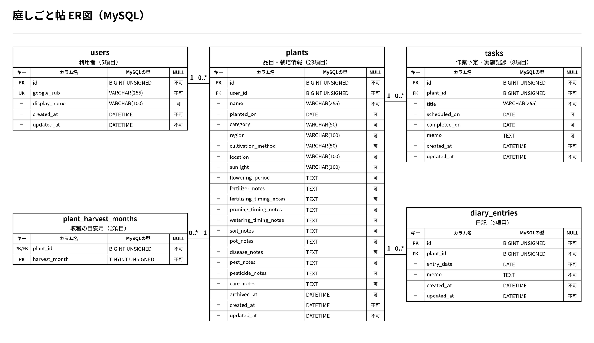

# 庭しごと帖 設計資料

書き出し日：2026-11-23

## ファイル一覧

| ファイル | 内容 |
| --- | --- |
| [lean-canvas.md](lean-canvas.md) | リーンキャンバス。シートの9項目をMarkdownに変換 |
| [design/wireframes.drawio](design/wireframes.drawio) | 全体の画面構成図と12の表示例。全13ページ |
| [design/er-diagram.drawio](design/er-diagram.drawio) | 全5テーブル・全44カラムのER図。MySQLの型・キー・NULL可否・リレーションを記載 |
| [design/er-diagram.png](design/er-diagram.png) | ER図の確認用画像 |

## 画面ID

| 画面ID | 画面名 | 表示例 |
| --- | --- | --- |
| S01 | ログイン | 通常 |
| S02 | 一覧・ホーム | カレンダー、品目一覧、アーカイブ、TODO |
| S03 | 品目追加・編集 | 追加、編集 |
| S04 | 品目詳細 | 通常 |
| S05 | 作業登録・編集 | 登録、編集 |
| S06 | 日記登録・編集 | 登録、編集 |

S02のタブ切り替えとS03・S05・S06の登録・編集では、同じ画面IDを使用します。

## 図の編集

`.drawio` ファイルをdraw.io（diagrams.net）で開いて編集できます。
ワイヤーフレームはページを切り替えると各画面を確認できます。

## ER図

